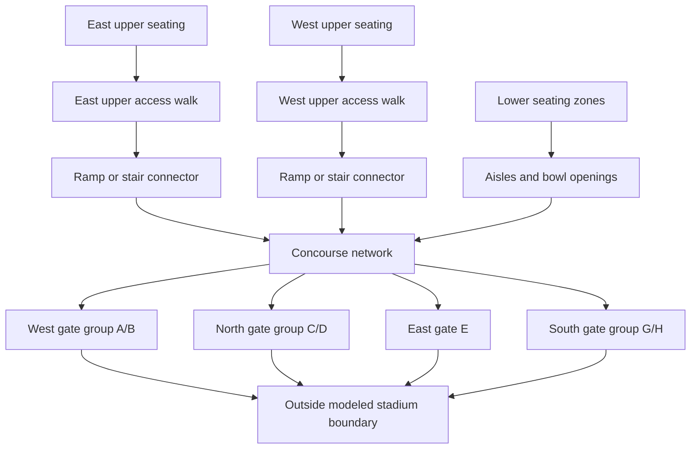

# SHI Stadium map study

Prepared 2026-11-12. Status: the schematic map viewer is implemented; stadium evacuation runs are not yet available.

The selected scenario is a football game with spectators starting in the stands. The current milestone is map geometry and connectivity. Individual demographic profiles, changes to movement speeds, collision-resolution upgrades, and alternative planning algorithms are later work.

## Implemented map viewer

From setup, choose **SHI Stadium · Map preview** in **Building layout**, then **View map preview**. The same map choice in the simulation controls pauses the run and opens the viewer. The viewer provides overview, 100-level, 200-level, and concourse/gate views; section and feature selection; published gate groups; proposed ramp/stair connections; elevator reference markers; zoom, background dragging, and a reset-to-fit control. The feature selector supports inspection on small screens and with a keyboard. Returning from a setup preview preserves unsubmitted experiment settings; returning from a simulation preview uses that run's settings.

- `src/maps/stadium.ts` contains the original schematic: 44 lower sections, 28 upper sections on separate east/west surfaces, four groups covering the seven published gates, four proposed connections, and two elevator references. It keeps source references alongside features. No Gate F or sections 215/216 are invented.
- `src/ui/StadiumViewer.ts` renders the schematic as SVG independently of the existing Canvas simulation. Shapes, the continuous concourse ring, and connector endpoints are explicitly approximate or proposed. No official raster image is bundled.
- Drawing coordinates have no meters-per-unit scale. Section populations, gate widths, connector travel times, and capacities are unknown. This preview does not calculate routes, evacuation time, or crowd density.
- The next milestone is a connected navigation model with section access aisles and explicit connector validation. The drawn dashed links alone do not make the stadium ready for movement.

## Public references and verified observations

| Reference | What it establishes | What it does not establish |
| --- | --- | --- |
| [Rutgers' 2026 stadium map](https://scarletknights.com/sports/2026/8/17/shi-stadium-map) and its [map image](https://scarletknights.com/images/2026/8/12/Website_Amenities_Map.jpg) | Section arrangement, field, gate groups, ramps, and stair symbols. Inspected the image directly. | Surveyed distances, floor elevations, individual door widths, and complete connector endpoints. |
| [Rutgers' football gate guide](https://scarletknights.com/sports/2026/8/17/gate-ticket-information) | A/B are west, C/D north, E east, and G/H south. | Emergency egress permissions, capacity, or a requirement to leave through the gate recommended for entry. |
| [Rutgers' football accessibility information](https://scarletknights.com/sports/2017/6/11/facilities-ada-shuttle-info-html) | Elevator access is described behind sections 101 and 138. | Whether either elevator can be used for a particular evacuation scenario, its stops, or its throughput. |
| [Rutgers' stadium facility page](https://scarletknights.com/sports/2017/6/11/facilities-football-html) | Published venue capacity of 52,454. | Per-section occupancy or a validated simulation population. |

The current map image has **east at the top, north on the left, south on the right, and west at the bottom**. The 200-level sections are 201-214 on the west side and 217-230 on the east side. The 100-level bowl surrounds the field; a separate band labels club sections 1-14. Ramps serving the 200 level and stair symbols are shown. These observations are from the [2026 map](https://scarletknights.com/sports/2026/8/17/shi-stadium-map).

Use the current football map as the primary reference. A commencement field-seating arrangement would describe a different initial population and is not the selected scenario. Do not infer missing section numbers or add a Gate F to make the numbering consecutive.

The sources found are visitor maps and access information. They are sufficient for a clearly labeled schematic, but not for claiming an exact floor-by-floor reconstruction.

## Recommended representation

Use connected 2D navigation surfaces, with a level selector and an overview. A full 3D renderer is optional later; it is not required to represent travel between levels.

These are **modeling layers**, not a claim that the real building has three uniform floors:

| Modeling layer | Content | Initial treatment |
| --- | --- | --- |
| Lower seating | 100-level section zones, seat-row access, aisles, and bowl openings | Spectator spawn zones. Movement follows aisle connections rather than crossing arbitrary rows or the field. |
| Upper seating | Separate east and west 200-level decks, their access walks, and connector endpoints | Spectator spawn zones. Do not connect opposite decks across empty space. |
| Circulation and exterior | Main concourse segments, gate approaches, and outside-boundary destinations | Model concourse continuity only where verified or explicitly assumed. Any overlapping passages need separate surface IDs. |

Premium seating, suites, and service areas should remain labeled reference geometry outside the initial simulated occupancy until their connections are documented. The field is visible but unavailable to spectator routes in the initial scenario; opening a field route would be a separate scenario assumption.

Suggested high-level topology, with exact connector locations still to be established:

This diagram proposes the model structure. It does not certify that every section can reach every gate in the real building. Where individual door positions are unknown, use a labeled gate group rather than inventing separate openings with exact widths.

## Map data needed before movement

- **Surface:** stable ID, display name, local coordinates, geometry, explicit scale status, and an optional verified elevation. Rendering coordinates and travel distances must be separate.
- **Section:** public section label, surface ID, seating-zone geometry, aisle-access locations, and scenario population. Leave actual seat counts unknown until sourced.
- **Connector:** ID, kind (stairs, ramp, passage, or elevator), two surface endpoints, direction, open/closed state, and provenance. Width, travel distance, rise, and capacity remain unset until measured or explicitly chosen as scenario assumptions.
- **Gate:** public name or group, approach surface, opening geometry, exterior destination, and scenario availability. Gate assignments for entry are not route restrictions for exit.
- **Evidence:** source URL, inspection date, and status (`observed`, `inferred`, or `assumed`) for geometry and connections.

Trace a schematic in normalized coordinates first. Do not derive accurate concourse or stair dimensions from the visitor illustration. Introduce an explicit meters-per-unit scale using a suitable measured reference before interpreting distance or timing physically. Approximate dimensions must stay visibly labeled as assumptions.

An initial crowd of 100-1,000 can exercise the geometry within the current engine limit. That does not represent full attendance. One simulated agent must not silently count as many real people when calculating collisions, density, or flow.

## How connectors should work when simulation is added

A stair or ramp is a traveled connection, not an evacuation exit. It needs a travel cost and a finite transfer capacity. People may have to queue before entering it and wait for room at the destination. A transition must preserve the person and elapsed simulation time; it must not instantly teleport everyone or count them as evacuated.

Keep all surfaces advancing on the same clock regardless of which one is displayed. Maintain separate collision and density neighborhoods for separate surfaces. Two people drawn at the same x/y position on different decks must not collide or contribute to each other's local congestion.

Track people as on a surface, traveling through a connector, or outside the model. Their combined count must equal the initial population. Completion for the initial scenario means crossing the modeled stadium boundary, not reaching a verified emergency assembly area.

Record elevator locations as reference data. Leave evacuation use unspecified until the scenario and the permitted accessible routes are established. A ramp or elevator icon alone does not establish an uninterrupted accessible route.

## Fit with the current code

- `src/maps/maps.ts` currently defines one grid per map and rectangular spawn areas. It needs a multi-surface definition and section-based spawn zones.
- `src/simulation/Grid.ts` can still represent individual surfaces. Local neighbors stay within one surface; explicit connectors provide inter-surface neighbors.
- `src/simulation/Agent.ts` currently has only x/y position and local grid waypoints. Multi-level movement will require surface-aware positions, path steps, and transfer state. This is location bookkeeping, separate from future behavioral profiles.
- `src/simulation/SpatialHash.ts` and `Density.ts` need separate instances or keys for each surface. Density units must reflect the chosen spatial scale.
- `Simulation.layoutConnectivityIssue` currently floods one grid from exit cells. The stadium validator must traverse connectors and confirm that each occupied zone has an allowed route to the exterior.
- `src/ui/Editor.ts` currently edits one grid. A stadium editor needs surface selection and connector-aware validation so an edit cannot leave a connector endpoint in a wall.
- Rendering can continue using Canvas with zoom, pan, a surface selector, a compass, and an overview. The overview must not imply walkable connections between visually overlapping surfaces.
- Keep planner choice behind a common surface-and-connector graph interface so future adaptive routing does not require rebuilding the stadium data.

## Implementation sequence and completion checks

1. **Map viewer and trace:** show the bowl, separate upper decks, section groups, concourse segments, gates, and connector markers. Include a compass and evidence/assumption legend. No evacuation results yet.
2. **Connected map:** add explicit connector endpoints and graph validation. Inspect sample routes from both upper decks and the lower bowl to exterior destinations. Block a connector and confirm that the graph identifies alternatives or reports disconnection.
3. **Movement on the map:** retain current behavior initially while implementing timed transfers, queues, and separate surface neighborhoods. Verify population conservation, no direct jumps between decks, and no cross-surface collisions or density leakage.
4. **Agent and algorithm updates:** address overlap resolution, evidence-based individual behavior, and adaptive planning after the map is stable. Compare changes on identical map and scenario inputs.

For a closer reconstruction, the highest-value missing material is a permitted floor/circulation plan or site observations identifying stair/ramp endpoints, aisle and gate widths, section access points, and relevant route restrictions. These can be collected while the schematic viewer is built. No exact geometry or capacity should be filled in merely to make the map appear complete.
