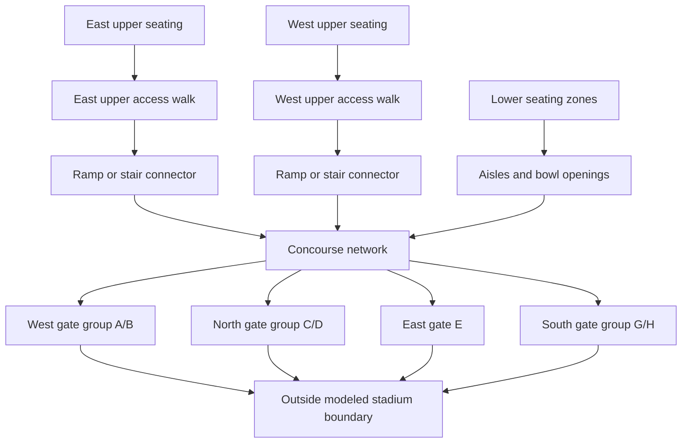

# SHI Stadium map study

Prepared 2026-11-12. Status: schematic viewer, connected routes, and baseline crowd movement with timed transfers and queues are implemented.

The selected scenario is a football game with spectators starting in the stands. Movement across connected surfaces now includes synthetic individual profiles and continuous body-clearance checks. See [agent behavior and collision handling](AGENT_BEHAVIOR.md) for the current model and its assumptions. Alternative adaptive planning algorithms remain later work.

## Implemented map viewer

From setup, choose **SHI Stadium · Schematic simulation** in **Building layout**, then **Open stadium**. The same map choice in the building simulation controls pauses that run and opens the stadium. The viewer provides overview, 100-level, 200-level, and concourse/gate views; section and feature selection; published gate groups; proposed ramp/stair connections; elevator reference markers; zoom, background dragging, and a reset-to-fit control. The feature selector supports inspection on small screens and with a keyboard. Returning from setup preserves unsubmitted experiment settings; returning from the building simulation uses that run's settings.

- `src/maps/stadium.ts` contains the original schematic: 44 lower sections, 28 upper sections on separate east/west surfaces, four groups covering the seven published gates, four proposed connections, and two elevator references. It keeps source references alongside features. No Gate F or sections 215/216 are invented.
- `src/ui/StadiumViewer.ts` renders the schematic as SVG independently of the existing Canvas simulation. Shapes, the continuous concourse ring, and connector endpoints are explicitly approximate or proposed. No official raster image is bundled.
- Measured geometry, section populations, gate widths, connector travel times, and capacities remain unknown in the source data. A separate scenario supplies explicitly assumed inputs for route inspection and movement. Simulated completion times are not predictions for the real stadium.
- Individual behavior and body-clearance checks are implemented. The next algorithm milestone is adaptive routing and comparison with established crowd-navigation methods.

## Connected route model (steps 1 and 2)

`src/maps/stadiumNavigation.ts` builds a surface-aware network independently of the original single-grid maps:

- Every section has one assumed aisle centerline with a corridor width. This is a coarse access model, not a reconstruction of individual seat rows.
- Lower sections connect to an assumed continuous bowl access walk. Each of the 44 sections has a proposed outward passage to the concourse. The number and locations of these openings are scenario assumptions, not published exit counts.
- East and west upper sections connect to separate access walks. Each deck reaches the concourse through its proposed ramp. The two south stair markers also have explicit lower-bowl and concourse endpoints.
- The concourse ring connects to four gate approaches and terminal exterior nodes. All corridor segments avoid the field, including clearance for the assumed corridor half-width. Suites, club seating and elevators have no navigation edges.
- Ordinary walking edges remain on one surface. Passages, ramps and stairs run toward the concourse; gates lead outside. Drawing intersections and overlapping decks never create connections. Closing a deck's only modeled ramp disconnects that deck; this is a model limitation, not a claim about the real venue's available exits.

The default values below are **experimental inputs, not measurements or validated crowd parameters**:

| Input | Assumed value |
| --- | --- |
| Drawing scale | 0.2 meters per drawing unit |
| Reference walking speed | 1.2 meters/second |
| Aisle / access walk / concourse width | 1.2 / 2.4 / 4.8 meters |
| Ramp transfer | 30 seconds, 2 people/second |
| Stair transfer | 12 seconds, 1 person/second |
| Bowl opening transfer | 3 seconds, 2 people/second |

`src/pathfinding/StadiumRouter.ts` uses deterministic Dijkstra search over explicit edges. Walking cost uses polyline length times the assumed scale divided by the reference speed; a transfer uses its assigned travel time instead of deriving it from the illustration. A reverse reachability traversal checks every section against all open gate destinations. Inputs are kept separate from the public-reference data, whose measured scale and transfer parameters remain unset.

In the viewer, choose **Route start section** and **Destination gate**. The highlighted route and its ordered steps update immediately. Select a ramp, stair, gate, or lower section in the feature inspector to close/reopen that connection. Lower-section controls operate its assumed bowl opening. Transfer time and capacity can be edited with validation. **Reset route assumptions** reopens every connection and restores transfer defaults. Layer selection and display toggles do not change connectivity.

Route-inspection times describe one illustrative journey without queues. The separate live simulation includes waiting and enforces transfer capacities. Physical dimensions need verification or calibration before drawing conclusions about the real stadium.

Automated checks cover all 72 sections to all four gate groups, valid geometry and surface transitions, field exclusion, isolated decks, gate/opening closures, alternate routes, parameter validation, deterministic reset, and desktop/mobile inspection.

## Movement on the map (step 3)

`src/simulation/StadiumSimulation.ts` implements a deterministic fixed-step flow model; `src/ui/StadiumCrowd.ts` displays it in the existing SVG viewer. The initial population is 100, adjustable from 1 to 1,000 within the selected schematic seating slots. Presets distribute people evenly across all sections, one seating surface, or sections 101 and 217. Seed 549 reproduces placement. These slots and equal section populations do not represent actual attendance or seat counts.

- Each person is seated, approaching a section aisle, at a junction, walking an edge, traveling through a transfer, or evacuated. Surface membership is explicit. In-transit people are counted separately until arrival; only exterior gate crossings increment evacuation counts.
- Coarse straight-line section access leads to a cleared aisle strip. Walking follows polylines at each person's preferred speed (or uniform 1.2 m/s for comparison). Swept body checks and conservative headways prevent penetration in tested scenarios. Short connected walking edges share a junction reservation without shrinking a body. Wider bidirectional walks have separate directional lanes. Actual seat rows, free lateral overtaking and calibrated use of full corridor width remain outside this model.
- Transfer admissions are spaced by at least `1 / capacityPerSecond`, without accumulating unused admission credits. In-flight occupancy is bounded by `ceil(capacityPerSecond * configured travelSeconds)`, at least one. Individual duration is the configured minimum multiplied by `max(1, 1.2 / preferredSpeed)`. Entry spacing and downstream congestion can reduce achieved throughput. A busy landing holds the leading traveler and queues followers; elapsed transit time never falls below the duration captured at admission.
- Closing a connection blocks new entries. Already admitted people finish that edge, then choose the lowest assumed-time route to an open gate. New time/capacity settings apply to subsequent admissions. A disconnected stationary person remains in place and recovers when a route reopens. Routes currently ignore queue costs; there is no learned or advanced AI controller in this milestone.
- All surfaces use the same 30 Hz simulation clock. Layer selection only filters rendering. Occupancy and spacing are keyed to graph edges/nodes, so overlapping drawings on separate levels never share a movement neighborhood. No stadium density heatmap is implemented yet.
- Leaving the stadium, hiding the tab, or editing the network pauses movement. Resuming has no wall-time catch-up. Resetting the crowd retains route assumptions and closures; resetting route assumptions does not relocate the crowd.

Live displays include elapsed simulation time, per-surface counts, in-transit counts, waiting/stranded people, transfer entrance occupancy, gate use, and average exit time among those already outside. On-surface + in-transit + outside always equals the starting population. Tests cover complete 100- and 1,000-person runs, transfer entry rates and minimum duration, landing backpressure/FIFO order, closures during transit, reopening, surface transitions, pause/reset reproducibility, and desktop/mobile controls.

## Public references and verified observations

| Reference | What it establishes | What it does not establish |
| --- | --- | --- |
| [Rutgers' 2026 stadium map](https://scarletknights.com/sports/2026/8/17/shi-stadium-map) and its [map image](https://scarletknights.com/images/2026/8/12/Website_Amenities_Map.jpg) | Section arrangement, field, gate groups, ramps, and stair symbols. Inspected the image directly. | Surveyed distances, floor elevations, individual door widths, and complete connector endpoints. |
| [Rutgers' football gate guide](https://scarletknights.com/sports/2026/8/17/gate-ticket-information) | A/B are west, C/D north, E east, and G/H south. | Emergency egress permissions, capacity, or a requirement to leave through the gate recommended for entry. |
| [Rutgers' football accessibility information](https://scarletknights.com/sports/2017/6/11/facilities-ada-shuttle-info-html) | Elevator access is described behind sections 101 and 138. | Whether either elevator can be used for a particular evacuation scenario, its stops, or its throughput. |
| [Rutgers' stadium facility page](https://scarletknights.com/sports/2017/6/11/facilities-football-html) | Published venue capacity of 52,454. | Per-section occupancy or a validated simulation population. |

The current map image has **east at the top, north on the left, south on the right, and west at the bottom**. The 200-level sections are 201-214 on the west side and 217-230 on the east side. The 100-level bowl surrounds the field; a separate band labels club sections 1-14. Ramps serving the 200 level and stair symbols are shown. These observations are from the [2026 map](https://scarletknights.com/sports/2026/8/17/shi-stadium-map).

Use the current football map as the primary reference. A commencement field-seating arrangement would describe a different initial population and is not the selected scenario. Do not infer missing section numbers or add a Gate F to make the numbering consecutive.

The sources found are visitor maps and access information. They are sufficient for a clearly labeled schematic, but not for claiming an exact floor-by-floor reconstruction.

## Recommended representation

Use connected 2D navigation surfaces, with a level selector and an overview. A full 3D renderer is optional later; it is not required to represent travel between levels.

These are **modeling layers**, not a claim that the real building has three uniform floors:

| Modeling layer | Content | Initial treatment |
| --- | --- | --- |
| Lower seating | 100-level section zones, seat-row access, aisles, and bowl openings | Spectator spawn zones. Movement follows aisle connections rather than crossing arbitrary rows or the field. |
| Upper seating | Separate east and west 200-level decks, their access walks, and connector endpoints | Spectator spawn zones. Do not connect opposite decks across empty space. |
| Circulation and exterior | Main concourse segments, gate approaches, and outside-boundary destinations | Model concourse continuity only where verified or explicitly assumed. Any overlapping passages need separate surface IDs. |

Premium seating, suites, and service areas should remain labeled reference geometry outside the initial simulated occupancy until their connections are documented. The field is visible but unavailable to spectator routes in the initial scenario; opening a field route would be a separate scenario assumption.

Suggested high-level topology, with exact connector locations still to be established:

This diagram proposes the model structure. It does not certify that every section can reach every gate in the real building. Where individual door positions are unknown, use a labeled gate group rather than inventing separate openings with exact widths.

## Map data and future calibration

- **Surface:** stable ID, display name, local coordinates, geometry, explicit scale status, and an optional verified elevation. Rendering coordinates and travel distances must be separate.
- **Section:** public section label, surface ID, seating-zone geometry, aisle-access locations, and scenario population. Leave actual seat counts unknown until sourced.
- **Connector:** ID, kind (stairs, ramp, passage, or elevator), two surface endpoints, direction, open/closed state, and provenance. Width, travel distance, rise, and capacity remain unset until measured or explicitly chosen as scenario assumptions.
- **Gate:** public name or group, approach surface, opening geometry, exterior destination, and scenario availability. Gate assignments for entry are not route restrictions for exit.
- **Evidence:** source URL, inspection date, and status (`observed`, `inferred`, or `assumed`) for geometry and connections.

Trace a schematic in normalized coordinates first. Do not derive accurate concourse or stair dimensions from the visitor illustration. Introduce an explicit meters-per-unit scale using a suitable measured reference before interpreting distance or timing physically. Approximate dimensions must stay visibly labeled as assumptions.

An initial crowd of 100-1,000 can exercise the geometry within the current engine limit. That does not represent full attendance. One simulated agent must not silently count as many real people when calculating collisions, density, or flow.

## Connector modeling requirements

A stair or ramp is a traveled connection, not an evacuation exit. It needs a travel cost and a finite transfer capacity. People may have to queue before entering it and wait for room at the destination. A transition must preserve the person and elapsed simulation time; it must not instantly teleport everyone or count them as evacuated.

Keep all surfaces advancing on the same clock regardless of which one is displayed. Maintain separate collision and density neighborhoods for separate surfaces. Two people drawn at the same x/y position on different decks must not collide or contribute to each other's local congestion.

Track people as on a surface, traveling through a connector, or outside the model. Their combined count must equal the initial population. Completion for the initial scenario means crossing the modeled stadium boundary, not reaching a verified emergency assembly area.

Record elevator locations as reference data. Leave evacuation use unspecified until the scenario and the permitted accessible routes are established. A ramp or elevator icon alone does not establish an uninterrupted accessible route.

## Fit with the current code

- `src/maps/maps.ts` exposes the stadium beside the original grid maps. `stadiumNavigation.ts` supplies the separate surface graph and validates its connections.
- `src/simulation/Grid.ts` and `Agent.ts` retain the original building experiments. `StadiumSimulation.ts` owns stadium surface positions, route steps and transit states independently of those grid agents.
- Future stadium use of `SpatialHash.ts` or `Density.ts` must include surface IDs in neighborhood keys. Density units must reflect the chosen spatial scale.
- `StadiumRouter.connectivity()` checks all sections through the explicit connectors to exterior gates. Runtime rerouting starts from each spectator's current node.
- `src/ui/Editor.ts` currently edits one grid. A stadium editor needs surface selection and connector-aware validation so an edit cannot leave a connector endpoint in a wall.
- Stadium rendering uses SVG with zoom, pan, a surface selector, a compass, and an overview. The overview must not imply walkable connections between visually overlapping surfaces.
- Keep planner choice behind a common surface-and-connector graph interface so future adaptive routing does not require rebuilding the stadium data.

## Implementation sequence and completion checks

1. **Map viewer and trace — implemented:** bowl, separate upper decks, sections, concourse, gates, connector markers, compass, and evidence/assumption legend.
2. **Connected map — implemented:** explicit endpoints and graph validation; inspect routes from both upper decks and the lower bowl to exterior destinations; report alternatives or disconnection after closures.
3. **Movement on the map — implemented:** timed transfers, capacity-limited admissions, landing queues, separate surface occupancy, and population conservation. The subsequent agent milestone adds body-clearance checks; free 2D overtaking and density analysis remain later extensions.
4. **Agent and algorithm updates — in progress:** individual profiles, uniform comparison and swept body-clearance checks are implemented. Profile coefficients remain explicit assumptions, not calibrated predictions. Adaptive planning and comparison with a continuous-space method such as ORCA remain future work.

For a closer reconstruction, the highest-value missing material is a permitted floor/circulation plan or site observations identifying stair/ramp endpoints, aisle and gate widths, section access points, and relevant route restrictions. These can be collected while the schematic viewer is built. No exact geometry or capacity should be filled in merely to make the map appear complete.
